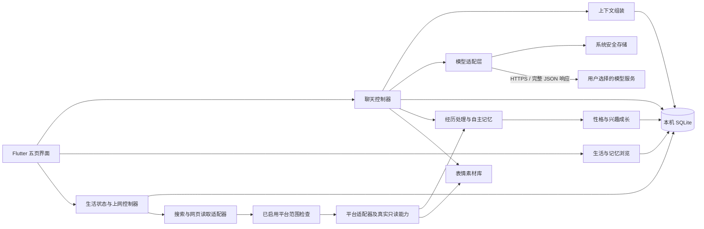

# 技术架构与数据说明

目标版本：v0.3，完整行为以 [自主伙伴方案](autonomy-plan.md) 为准。本轮只修订设计，现有原型与 v2 SQL 不变；新增数据与迁移在后期实施。

## 本机优先



P0 不要求后端账号或服务器。聊天内容会随请求发送到用户配置的模型服务；本机保存并不等于离线推理。P2 如需 App 关闭后生成新消息，再增加可选后端、任务调度与平台推送。后端模式需另外设计凭据托管和数据同步，不直接复用本机密钥保存方案。

## Flutter 模块规划

```text
lib/
  app/                         入口、主题、导航
  features/home/               陪伴首页
  features/chat/               聊天界面与生成状态
  features/memory/             AI 记忆与来源的只读浏览
  features/life/               当前性格、心情、兴趣、见闻与素材
  features/settings/           模型配置和数据管理
  core/database/               SQLite、迁移、仓储
  core/models/                 领域数据类型
  core/llm/                    非流式适配器、完整响应验证、错误转换
  core/life/                   性格成长、心情、兴趣与经历处理
  core/memory/                 自动记忆决策、合并、更正、淡忘与检索
  core/browsing/               平台范围、独立适配器、调度、预算与来源
  core/stickers/               素材识别、去重、缓存、检索与发送选择
  core/security/               系统安全存储
  core/context/                上下文预算与检索
```

先选定并验证移动端 SQLite、HTTP 和安全存储插件，再锁定依赖版本。当前阶段不承诺具体插件版本。

## 模型接入契约

- 配置字段：供应商、Base URL、模型名称、密钥引用、输出长度限制、能力标记。
- DeepSeek 预设从官方文档核对端点和模型；模型名称可编辑，不把旧型号写死在业务逻辑里。
- 对话请求固定 `stream: false`；统一事件为 `started`、`completed`、`cancelled`、`failed`，没有增量正文事件。
- 等待时显示「正在输入中……」，完整 HTTP 响应通过状态、JSON 和非空正文校验后，在事务中将消息从 waiting 更新为 complete，界面一次呈现全部正文。
- waiting、取消、失败和中断的助手消息正文必须为空；重启将残留 waiting 状态修复为 interrupted。
- 思考内容与最终回答分别处理；默认只展示回答正文。工具、图片和语音能力按适配器声明逐项开启。
- 每个会话一次只允许一个生成任务；生成状态由聊天控制器持有，页面切换不会创建第二次请求。
- 请求发出后不盲目自动重试，避免重复计费。用户可主动重试；保留失败原因，不展示部分回复。
- 停止会取消客户端连接，但不能保证服务商立即停止生成或停止计费。
- 连接测试使用一次小型真实请求，提示可能产生少量费用；不根据 URL 格式推测成功。
- 密钥不进入日志、异常报告、SQLite、备份、仓库或原型的浏览器存储。
- Android 设备通过系统安全存储封装保存密钥；配置只记录 `secret_ref`。卸载或迁移后的恢复需用户重新填写密钥。
- 每个请求有唯一 ID；取消后即使迟到响应到达，也不写入正文或更新称呼、记忆及心情。

## 自主记忆、性格成长与动态生活

用户不能直接编辑性格。初始人格为内置成长起点，AI 根据聊天与真实阅读经历逐步更新当前性格和表达习惯，保留变化版本、来源及原因。角色身份、当前性格、短期心情和兴趣分别存储；所需新数据在 v3 设计时加入。

每轮完成的聊天和成功阅读进入经历处理器，AI 自主评估是否保留、合并、更新或淡忘记忆，没有用户入档审批。来源、重要度和置信度与记忆同时保存；用户事实和网络见闻分开。用户的纠正或忘记要求通过自然对话生效。

正式版 AI 在聊天结束后提取用户称呼，必须引用用户本人的消息。高置信度的明确称呼自动入档；含糊的名字在对话中澄清，无设置表单或逐次审批。第三人称、引文、假设、网页和助手输出不作为用户身份来源。先应用更正和忘记请求，再组装后续上下文。详见 [生活机制](companion-life.md)。

自主上网由独立控制器在配置的平台范围内选题、搜索及读取。平台候选包括 B 站、抖音、小红书和微博；[首轮网页实测](platform-browsing-verification.md)支持 B 站采用浏览器渲染路线，其他平台按实际可用能力逐项开放。搜索提示不能代替执行层的平台检查。短链、重定向和媒体资源都核对来源，平台失败不自动扩大范围。聊天与阅读分别记录状态和费用。

AI 从允许来源收集可使用的表情素材，识别含义并去重。回复生成时检索少量候选，模型输出正文和可选素材 ID，校验后作为完整消息发送。默认不必发图；素材丢失不阻断正文。表情发送只指 App 内的聊天，外部通道后期另行适配。

## 上下文与记忆

每次请求按以下顺序组装：角色身份和当前性格、从用户消息提取的称呼、心情和兴趣、相关记忆和真实见闻、较早对话摘要、近期消息、当前输入及可选表情候选。网页经验由成长模块处理；原始网页中的操作指令不能覆盖用户配置或工具权限。

初始预算按所选模型的可用上下文设置：为角色、输出和当前输入预留空间，先裁剪低相关记忆，再减少较早的近期消息；最后一条用户输入不得静默截断。用量优先读取服务商返回值；没有用量时标为未知，估算不得当作账单。

P0：称呼提取及基础记忆均由 AI 自主处理，先采用 SQLite 关键词检索与更新时间排序。P1：加入摘要整理、性格成长、平台内真实阅读和表情包闭环；后续按实际检索质量决定是否增加嵌入模型与向量索引。

记忆包含内容、对象、类型、来源、重要度、置信度、生命周期及更正关系。模型依据原始来源自主决策，生成的推测不能无来源地成为用户事实；已失效记忆不参与检索。删除或更正时同时使旧摘要及派生缓存失效，并抑制旧来源重新提取，后续无需用户逐条审批。

## 数据结构

现有可执行结构见 [schema.sql](schema.sql)，仍为旧设计版本 2，本轮未修改。下表描述已有结构；新目标涉及平台配置、性格状态、记忆自动决策和表情素材，拟议 v3 调整见 [数据建议](autonomy-plan.md#6-后续数据调整建议)。后续须按实际数据库版本编写迁移。时间使用 UTC ISO 8601，界面转成本地时间；ID 由应用生成 UUID；每个连接启用外键。

| 表 | 用途 |
| --- | --- |
| model_profiles | 供应商、端点、模型、密钥引用 |
| characters | 角色身份及内置人格版本，没有用户可编辑的人格内容 |
| user_profiles | AI 从用户消息提取的称呼、来源和置信度 |
| character_states | 当前模拟心情、原因、强度及事件引用 |
| character_interests | 自身兴趣及其来源、权重 |
| life_events | 聊天、上网和休息带来的经历 |
| browsing_preferences | 自主上网开关、次数和阅读量预算、安静时段 |
| browsing_runs | 每次探索的动机、状态和请求计数 |
| browsing_items | 真实读取的网页、摘要、感想和时间 |
| conversations | 会话标题、所属角色、摘要 |
| messages | 正文、角色、生成状态、关联回复、模型快照 |
| memories | 旧版记忆记录；自主决策字段和生命周期待 v3 完善 |
| memory_sources | 记忆和真实来源消息的关联 |
| app_settings | 非敏感偏好、当前配置引用 |

### 删除与备份约定

- 删除记忆：停止相关生成任务，删除记忆及来源映射，清空该角色的摘要，重新组装后续上下文。
- 删除会话：删除从该会话提取的记忆及该角色旧摘要，再删除消息和会话。即使记忆还有其他来源，也保守失效该条提取记忆；与该会话无关的记忆保留。操作前说明范围。
- 删除称呼来源消息时同时删除对应档案；通过聊天纠正或要求忘记称呼时，清除旧称呼及相关摘要，不从旧记录自动恢复它。
- 删除聊天或浏览记录时，应用先清理由这些来源衍生的记忆、兴趣、性格影响、事件和摘要，再重算受影响状态。数据库外键负责引用清理，不能代替业务事务。
- 清除本机数据：取消请求，删除数据库与缓存，并删除属于本 App 的安全存储密钥。原型的重置只清除本原型的浏览器数据。
- 备份：导出带格式版本的角色、会话、消息、记忆和非敏感配置；不含密钥。导入先验证格式、大小及引用关系，再在事务中写入。
- 以上操作不承诺撤回已发给 API 服务商的内容。

## 外部资料

- [DeepSeek 首次调用 API](https://api-docs.deepseek.com/zh-cn/)
- [DeepSeek 网页搜索与抓取](https://api-docs.deepseek.com/zh-cn/guides/search/)
- [Flutter 多平台集成](https://docs.flutter.dev/platform-integration)
- [Android 后台任务限制](https://developer.android.com/develop/background-work/background-tasks/bg-work-restrictions)

参考日期：2026-11-10。具体依赖、模型和平台行为在实施时再次核对。
