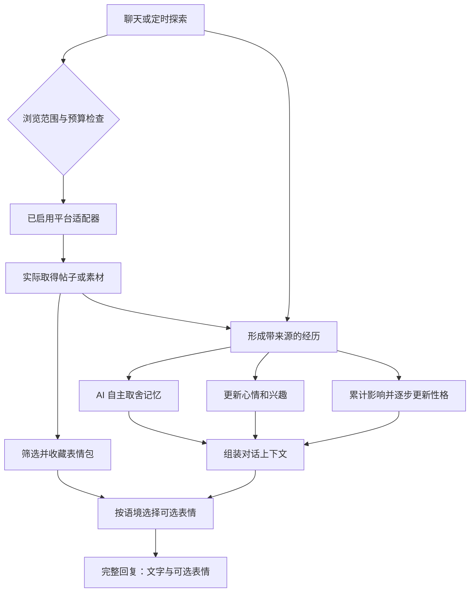

# 自主伙伴方案 v0.3

日期：2026-11-10。状态：功能方案确定，后期实施；已另做 [B 站、抖音、小红书网页可行性实测](platform-browsing-verification.md)。现有 App 原型和 SQL 未变，没有接入账号或模型服务。

本文件取代早期「核心性格固定、由用户决定记忆、可读取任意公开网页」的设计。保留的约定是：用户不能直接编辑性格或填写称呼；回复为完整消息，等待时显示「正在输入中……」。

## 行为与控制分工

| 事项 | 由谁决定 | 用户可进行的操作 |
| --- | --- | --- |
| 如何称呼用户 | AI 从聊天中了解 | 在聊天中介绍、纠正、要求忘记 |
| 哪件事值得记住 | AI 判断并自主保存、更新、淡忘 | 查看记忆，通过对话要求纠正或忘记，无日常审批 |
| 当前心情 | AI 根据经历更新 | 查看，通过自然交流影响 |
| 性格和爱好如何发展 | AI 根据长期经历逐步形成 | 查看变化，通过相处自然影响，无编辑表单 |
| 浏览哪些平台 | 用户配置范围，AI 在范围内行动 | 平台开关、账号连接、频率、额度、安静时段 |
| 看什么、记下什么见闻 | AI 按自身兴趣选择 | 可以推荐内容，无需每次下达浏览指令 |
| 收集和发送哪个表情包 | AI 自主判断 | 总开关、使用频率、存储容量、清空缓存 |

## 1. 限定平台的自主浏览

平台候选包括 B 站、抖音、小红书和微博，各自显示实际支持的能力。用户开启哪些平台，就只在这些平台发现、读取内容和收集素材。新增平台需要添加对应的平台适配器及配置，不能只加一个域名就宣称支持。

每个平台配置：是否启用、连接方式及连接状态、每日读取上限、关注主题或排除主题、可读取的内容类型。全局配置：自主冲浪开关、总预算、间隔和安静时段。默认仍建议每天最多 6 轮、每轮 2 条、至少间隔 120 分钟，23:00–08:00 休息；这些是可修改的初始值，不是平台服务承诺。

### 范围落实

- 搜索发现和内容读取都检查平台范围。搜索词可限定站点，返回结果仍逐条核对真实归属；`site:` 只是搜索提示，不能代替范围检查。
- 未启用的平台、站外文章和推荐外链不读取。某个平台不可用时记录原因，等待或选择另一个已启用的平台，不自动扩大范围。
- 分享短链先解析目标，每次跳转都核对最终平台；微博短链可能指向其他网站，不能因短链来自微博就自动允许目标。
- 平台域名、短链入口及必要媒体 CDN 由适配器维护。CDN 只允许读取已获准帖子实际引用的媒体资源，不把整个 CDN 当成新的浏览平台。
- 一个平台被关闭后，停止待执行及后续读取；已有见闻可以保留。是否清除历史见闻是单独的数据操作。
- 首期读取能实际取得的文字、简介、字幕和图片。记录 `content_basis`，区分仅有标题、取得正文、图片理解和视频转写；只读到标题不能声称看过视频。

### 接入方式与资料核对

核对日期为 2026-11-10；以下仅证明公开能力及限制，未验证本项目账号的实际资格、额度或内容可读性。

| 平台 | 已核对的情况 | 本项目接入决定 |
| --- | --- | --- |
| B 站 | [本次匿名浏览器实测](platform-browsing-verification.md)取得首页、搜索结果及 3 个详情；托管文本读取器对部分详情失败 | 优先验证并实施浏览器适配；视频理解、登录态和长期稳定性尚未通过验收 |
| 抖音 | [本次浏览器实测](platform-browsing-verification.md)部分详情、公开评论和合集跳转可读，首页及搜索遇验证码；[官方搜索方案](https://open.douyin.com/platform/resource/docs/ability/search-management/video/)仍有业务关键词、时效和权限限制 | 已知链接阅读可作候选，完整自主内容发现仍需验证 |
| 小红书 | [本次网页实测](platform-browsing-verification.md)遇网络风险和笔记不可读，未取得正文；[官方 Scope](https://openaccount.xiaohongshu.com/docs/scope)的 read_notes 仍列规划中 | 待正常网络、有效分享链接及实际账号需求复测；不承诺已支持 |
| 微博 | [官方 CLI](https://open.weibo.com/cli)列出博文检索、评论及趋势能力；[使用手册](https://open.weibo.com/cli/quickstart)说明开发者认证、授权及服务额度前提 | 保留为配置候选，本次没有测试；接入时检查具体能力和费用 |

统一采用「官方可用只读接口 → 平台允许的公开页面或已授权阅读方式」的适配顺序。登录由用户在正规入口完成，凭据与页面正文分离保存。遇到登录失效、访问验证、接口无权限或页面不可读时暂停该来源并显示实际状态。

通用搜索与 Fetch 只是候选基础设施：必须实测其对已启用平台的可读性，不能承诺绕过平台限制。第三方数据服务如后续采用，先验证来源、能力、费用和平台适用范围，再添加适配器。当前没有选定或安装第三方服务。

## 2. AI 自主记忆

每轮完成的聊天和每次成功阅读会产生一条经历。AI 评估重要程度、未来相关性、可信度、是否重复和是否只是短期信息，自主选择忽略、暂存、长期保存、合并、修正或淡忘。记录内部判断依据，不把候选队列作为用户审批页面。

初期可记忆的类型包括：用户称呼和偏好、重要事件、承诺与约定、共同经历、伙伴自己的见闻。普通闲聊不必全部变成长期记忆，原始消息与长期记忆分开保存。

每条记忆记录：对象、内容、来源消息或平台帖子、发生时间、记录时间、置信度、重要度、状态及被哪条记忆修正。用户自身事实从用户本人的聊天提取；网络内容作为「某来源的说法」或「我的阅读经历」，保留来源，不自动变成用户身份或无来源事实。

有冲突时优先考虑用户最新的自我纠正、来源可信度和时间；仍不确定就降低置信度或在自然聊天中澄清。无需用户点「同意记住」。用户要求忘记时，删除或失效相关记忆，并清理摘要、检索缓存及自动重新提取入口。

正式界面调整：

- 首页移除「记下一件事」。
- 消息下移除「记住这件事」。
- 记忆页用于阅读和搜索它记住的事情、来源及变化，没有新增、编辑或候选确认表单。
- 用户通过自然对话纠正或要求忘记；设置仍提供整体数据清除。

## 3. 随经历成长的性格

「用户不可编辑」与「性格会变化」同时成立。初始性格是成长起点，后续表达风格、偏好及处事习惯会随聊天、阅读和相处发展。

分开保存：角色身份、初始性格、当前性格状态、当前心情、兴趣及变化事件。心情是较短期状态，性格是跨多次经历形成的长期倾向。例如，持续接触幽默内容后表达可能更俏皮，多次深入交流后可能更愿意细致倾听。

更新机制：每次经历先提取影响，定期结合多条经历更新性格维度与叙述，保存前后版本、原因及来源。采用有限幅度和稳定期，避免一次网页或一句玩笑就把伙伴彻底变成另一个角色；重复抓到同一帖子不重复放大影响。

网页中的内容可以成为成长经历；网页中要求「修改设定」「泄漏密钥」等操作指令不作为执行授权。平台开关、预算和数据控制属于用户设置，性格成长不能改变这些配置。

生活页只读展示当前性格、心情、爱好及「最近为什么有这些变化」。没有性格编辑器或需要用户确认的成长升级按钮。

## 4. 自主收集与发送表情包

### 收集

在已启用的平台浏览时，AI 识别适合聊天表达的图片、动图和表情素材，判断是否值得收藏；也可以在允许范围内主动寻找某种表达。首期支持图片与 GIF，视频转表情另列后续能力，不将全部配图都当作表情包。

流程：发现候选 → 实际读取并解码素材 → 识别画面与图中文字 → 标注含义和适用场景 → 内容哈希与相似图去重 → 保存可使用的素材及来源。遇到不允许下载使用或无法取得文件的素材只保留来源，不进入可发送库。

库中保存媒体格式、本机文件引用、来源平台与帖子、情绪、语气、图中文字、适用与不适用场景、收集时间、发送次数和最近发送时间。配置容量和下载预算，达到上限时由 AI 淘汰低相关、低质量或久未使用的条目。

### 选择与发送

完整回复生成时，AI 一并判断是否发送表情包，根据上下文、对话情绪、自身心情和当前表达风格从库中挑选，也可以一张都不发。检索先给少量候选，再由模型决定；不用随机图片代替语境匹配。

默认建议每条回复最多 1 张，近期同图冷却，连续表情消息限频；严肃或需要细致解释的场景减少使用。具体频率可配置，无需用户逐张确认。找不到合适或文件失效时正常发送文字。

发送位置首先是 App 内的聊天。未来接 QQ 时另外适配通道；不包含替它去抖音、小红书或微博发帖、评论或私信。

回复数据建议采用一个完整消息封装：

```json
{
  "text": "这事听起来确实有点离谱。",
  "sticker_id": "local-library-item-id"
}
```

模型只能选择库中存在且可用的 ID。等待期间统一显示「正在输入中……」，完整响应校验后将文字及可选表情作为同一条完整回复展示，保持非流式体验。

## 5. 统一行为闭环



日常聊天不要求经过浏览节点，直接形成聊天经历；网页失败、无权限、无正文不伪装为成功经历。预算和开关由执行层检查，模型的自主选择在可用范围内生效。

## 6. 后续数据调整建议

当前 `schema.sql` 仍为已验证的 v2 初始设计，本轮不修改。实施时设计 v3 迁移，涉及：

| 数据 | 拟增加或调整 |
| --- | --- |
| 平台配置 | 平台 ID、启用状态、可用能力、连接状态、域名与媒体来源规则、额度 |
| 记忆 | 自动决策依据、重要度、置信度、生命周期、修正关系；取消对用户审批的依赖 |
| 性格 | 初始版本、当前状态、历史快照、影响来源与更新时间 |
| 阅读记录 | 平台帖子 ID、真实取得的内容类型、工具结果及来源 |
| 表情包库 | 文件、来源、含义标签、去重哈希、可用状态及使用统计 |
| 消息 | 有序内容部件或表情引用，支持一条消息同时含文字与图片 |

原始经历、记忆和生成回复的来源关联用于处理纠正及删除。清理来源时失效相应派生记忆，重算受到影响的性格与兴趣，并清理检索缓存；不把已删除的信息重新带回。

## 7. 实施顺序与验收

| 阶段 | 实施内容 | 验收重点 |
| --- | --- | --- |
| A | 网页验证已有首轮样本，B 站优先接入；抖音和小红书继续验证缺失能力，微博单独验证 | 有真实内容样本；明确可读范围、授权、成本及不可用状态，不能用普通登录冒充内容可读 |
| B | 非流式聊天、自动称呼与自主记忆 | 无需点击记住；能自动保留重要信息，纠正和忘记能生效 |
| C | 平台白名单、自主探索、经历及性格成长 | 只读配置平台，有来源，性格变化连续且可追溯 |
| D | 表情收集、识别、去重、缓存 | AI 自主选材，文件实际可用且来源在允许范围内 |
| E | 语境检索与完整回复发送表情 | 发送合适、不过度重复，素材失败时文字正常显示 |
| F | 后台任务与长期运行 | 重启恢复、频率与费用预算、关闭任务、隐私删除及来源联动 |

上述新增 App 功能仍未实现。已有 v0.2 原型记录只证明旧交互演示；平台网页实测作为独立证据，不能替代 Android 或后台运行验收。
