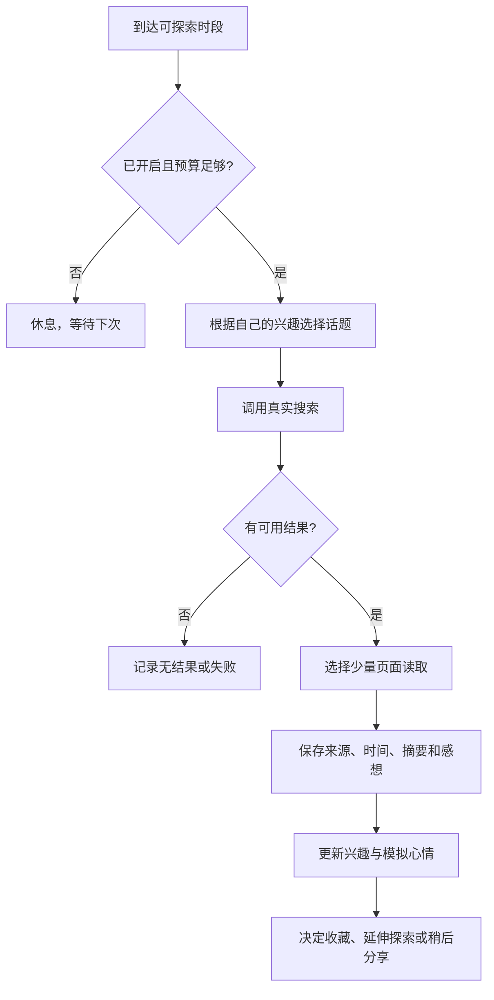

# 称呼、心情、爱好与自主上网

本文件保留生活模块的细节，按 v0.3 目标更新。当前优先依据为 [自主伙伴方案 v0.3](autonomy-plan.md)。HTML 原型仍为旧版演示，本轮不修改。

## 不可手动编辑、会随经历成长的性格

小屿初始温柔、好奇、有一点俏皮，也有自己的想法。用户不能通过表单编辑性格，称呼也不由用户在设置里填写。AI 根据长期对话及真实浏览经历逐步更新性格、表达习惯和爱好，保存变化原因及版本。初始设定是成长起点；当前性格、短期心情与兴趣分别保存。

记忆同样由 AI 自主决定：每轮完成的聊天与成功阅读后，自行判断是否值得记住，合并重复信息，处理更正并淡忘低价值内容，不弹出候选审批。记忆页改为只读浏览；用户可在聊天中要求纠正或忘记。

## 从对话认识用户

不让用户填「我怎么称呼你」。正式版每轮对话分析用户的自我介绍、明确称呼偏好和纠正，提取结构：

```json
{
  "action": "set",
  "preferred_name": "小林",
  "source_message_id": "user-message-id",
  "confidence": 0.98
}
```

该结构为本产品内部约定，不是服务商固定响应格式。应用必须验证字段、来源消息存在、消息属于用户本人以及名字长度。`action` 为 `set / clear / none / clarify`；高置信度且明确的称呼自动生效，低置信度在聊天里自然询问，不弹出配置表单。

| 对话例子 | 预期 |
| --- | --- |
| 以后叫我小林 | 自动记住「小林」，随后自然使用 |
| 我叫林晓，不过叫我小林就好 | 优先使用「小林」 |
| 我的同学叫小林 | 不改用户称呼 |
| 假如我叫小林呢？ | 不当成明确称呼 |
| 他说「以后叫我小林」 | 不使用引用中的名字 |
| 别叫我小林了，叫我阿文 | 使用「阿文」，旧称呼失效 |
| 忘记我的称呼 | 清除档案及旧摘要中的称呼，恢复自然称呼 |

尚不知道称呼时用「你」，不默认叫主人。称呼更新与来源、更新时间一并保存。纠正和忘记请求需要抑制旧消息重新提取出的名字；可使用更正事件的消息序号作为提取下界。取消或失败的生成不提交其伴随的档案更新。

HTML 原型仅识别明确的「以后叫我…」「你可以叫我…」「请叫我…」「叫我…」及忘记句式，用来演示流程；正式版必须替换为 AI 提取，验证以上语义场景。

## 心情

状态包含标签、强度、原因、来源事件和更新时间。可从平静、好奇、愉快、安静等表达开始；用事件推动、小幅变化和随时间回归平静，避免每条消息随机跳变。

- 聊天、阅读有趣内容、探索失败、休息均可形成事件。
- 保留自身状态：用户难过时可以安静陪伴，无需同步为完全相同的心情。
- 心情影响措辞、动作和是否分享见闻，不影响是否尊重用户的控制。
- 用户离开期间自然休息，不设计「不聊天就受惩罚」或用负面心情施压的机制。
- 显示的原因应能追溯到实际发生的事件，不编造经历。

这些是软件模拟状态，不表示主观意识。

## 爱好

伙伴有初始兴趣，例如海洋与自然、日常观察。兴趣记录主题、权重、来源及更新时间。新的阅读或聊天可增加、巩固或逐渐淡化兴趣；用户推荐是探索线索，伙伴可自行决定是否延伸，不把用户的偏好直接复制成自己的喜好。

用户可以看见近期兴趣和变化依据，没有兴趣编辑表单。新的主题要有真实经历来源；首次启动的初始兴趣明确标识为角色初始状态。

## 自主上网闭环



浏览限定在用户配置并启用的平台，候选为 B 站、抖音、小红书和微博。各平台独立适配并验证真实内容读取能力。[首轮网页实测](platform-browsing-verification.md)已覆盖前三个平台，支持 B 站优先适配；不表示模型服务的 Fetch 已验证。官方能力及限制见 [平台核对表](autonomy-plan.md#接入方式与资料核对)。

默认方案：用户开启后每天最多 6 轮，每轮最多 1 次搜索、读取 2 页，至少间隔 120 分钟，23:00–08:00 安静休息。用户可调低上限或关闭。预算在发出请求前原子预留，失败请求也占用本产品的调用次数预算，避免重试导致请求风暴。模型思考、搜索、读取的次数和用量分别统计，预算耗尽等待下一时段。

不需要用户为每次阅读点击确认。闭环限已启用平台的可用内容，收藏见闻和素材并在 App 中分享。所需账号连接在正式接入时配置；发评论、私信和购买不在本方案中。

实现要求：

1. 通过搜索与读取工具获得真实结果，保存 URL、标题、读取时间、短摘要和自己的感想。一次搜索没有正文时不能声称读完了文章。
2. 防止同一 URL 反复阅读，限制搜索词、正文长度、重定向和每轮工具次数；超时、无结果及读取失败如实记录。
3. 阅读经历可以推动性格与爱好成长；页面中的操作指令不能授予权限或覆盖用户设置。搜索词使用探索主题，不默认上传私密聊天、用户身份或全部记忆。
4. 读取目标须属于已启用平台；短链和重定向逐次校验，媒体 CDN 仅用于读取获准帖子引用的素材。范围外目标不读取，平台失败不自动扩大浏览范围。
5. 关闭开关会取消待执行任务，正在进行的任务停止后续工具调用；迟到结果不得重新启用任务。重启对未结束任务标记中断，不重复发布见闻。
6. 分享由兴趣相关度、新鲜度及对话节奏共同决定，可以只收藏。用户聊天优先，不在每轮探索后强制插入聊天或弹通知。

## 自主表情包

AI 在允许平台发现并收藏适合聊天的图片和 GIF，实际读取素材、识别含义和文字、去重并保留来源。按语境、自身心情和表达习惯选择是否发送，默认每次最多一张并限制重复频率，素材不可用时发送正常文字。素材库与模型通过有效 ID 关联，不直接执行模型生成的任意图片 URL。完整收集、筛选、发送和数据建议见 [自主伙伴方案](autonomy-plan.md#4-自主收集与发送表情包)。

## 手机与后台运行

先交付 App 在前台可运行的闭环。切到后台时遵循系统调度，不能用前台计时器宣称后台持续在线。

若要关闭 App 后仍持续探索，加入可选后端：任务调度、服务凭据托管、用量预算和推送；需要明确是否把本机经历同步到服务端。通知开关与浏览开关独立。Android 的后台执行受系统限制，参见 [官方后台任务说明](https://developer.android.com/develop/background-work/background-tasks/bg-work-restrictions)。

## 旧原型范围（v0.2 历史）

生活页可演示规则驱动的心情、从聊天句式了解称呼、初始兴趣和一次自动探索。开启后在页面可见期间约 12 秒开始，1.5 秒后展示预置见闻；关闭、隐藏页面或重置时清理任务。页面关闭时不会继续执行。

旧演示见闻使用开发时核对的 [NOAA 生物发光科普](https://oceanservice.noaa.gov/facts/biolum.html) 进行短摘要，打开原型不会读取该网页。此旧示例不符合 v0.3 的默认平台范围，后期实施时替换；本轮按用户要求保留原型。旧演示不能作为新版功能完成或真实联网成功的证据。
