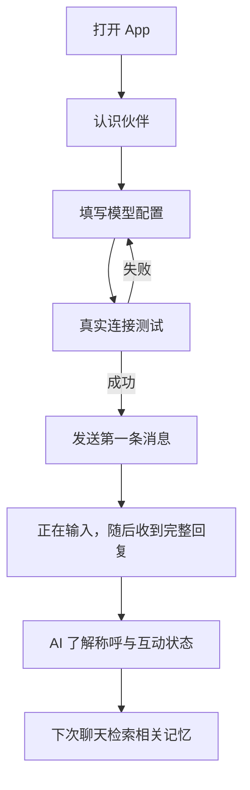

# 产品与页面设计

版本：v0.3 目标方案。新增能力后期实施，当前 HTML 原型仍为旧版 v0.2。完整行为与平台核对见 [自主伙伴方案](autonomy-plan.md)。

## 定位与默认决策

青屿是带角色形象、持续人格和可管理记忆的个人 AI 伙伴。希望用户获得的体验是：交流自然、相处连贯、重要的事情能被记住。

当前默认：个人自用、Android 优先、Flutter 开发、一个伙伴、一个正在使用的模型配置、本机存储、自备 API Key。用户不能直接编辑性格；AI 根据聊天和实际浏览经历逐步发展性格与爱好，自主选择记忆。如何称呼用户由 AI 在聊天中了解。iOS 仍需单独构建、签名和真机验证。

## 功能优先级

| 优先级 | 功能 | 范围 |
| --- | --- | --- |
| P0 | 模型配置 | DeepSeek 预设、自定义 HTTPS 地址、模型名称、连接测试、切换配置 |
| P0 | 文字聊天 | 非流式完整回复、正在输入提示、取消等待、重试、复制、重新生成、历史记录 |
| P0 | 角色与称呼 | 初始性格、无手动编辑入口、AI 从对话了解称呼及接受纠正 |
| P0 | 生活状态 | 模拟心情、初始兴趣、基于真实互动的状态变化，生活页只读展示 |
| P0 | 自主记忆 | AI 自主决定保存、合并、更正和淡忘，用户可查看及在聊天中要求纠正或忘记 |
| P0 | 本机数据 | 重启保留、删除会话、清除数据、密钥独立安全保存 |
| P1 | 长期整理 | 历史摘要、来源、冲突处理和相关检索，不要求用户审批记忆 |
| P1 | 性格成长 | 对话和真实阅读经历驱动缓慢变化，保留变化原因和版本 |
| P1 | 陪伴表现 | 待机和聊天动画、基于真实经历的日记 |
| P1 | 平台内自主上网 | 在可配置的 B 站、抖音、小红书、微博等已启用平台内探索，积累见闻与兴趣 |
| P1 | 自主表情包 | 从允许的平台收集、识别、去重，按语境选择并发送 |
| P2 | 主动互动 | 用户开启、频率限制、免打扰、通知权限、关闭入口 |
| P2 | 语音 | 分别接入语音识别和语音合成服务 |
| P3 | 外部入口 | QQ、跨设备同步、多伙伴、多模态，分别评估与实现 |

第一版先实现 P0；P1 完成性格成长、平台内自主浏览与表情包闭环。[首轮网页实测](platform-browsing-verification.md)支持 B 站优先适配，抖音仅部分链接可读，小红书当前环境未通过。当前原型仍为旧版演示；手动记忆、固定性格和站外示例在后期改造时移除，不能作为新方案完成依据。

## 五个页面

### 1. 陪伴首页

- 角色插画、伙伴名字、模拟状态、最近的一句话。
- 「聊一会儿」进入聊天；记忆入口展示 AI 自己记住的事情，没有「记下一件事」按钮。
- 日记预览进入一条演示日记，正式版没有真实聊天时展示空状态。
- 初次安装展示配置引导，未配置 API 时仍可浏览角色和记忆。

### 2. 聊天

- 顶部展示伙伴和当前模型；消息以时间顺序排列。
- 发送后显示「正在输入中……」，收到完整回答后一次展示整条消息，没有逐字输出效果。
- 等待期间可取消；取消后不展示半条消息，不接收该请求的迟到结果。失败和中断也不展示部分正文。
- 可复制正文；没有「记住这件事」按钮，AI 自主决定是否入长期记忆。支持针对指定助手回复重新生成。
- AI 按语境决定是否发送已收藏的表情包，文字与可选表情一起作为完整回复展示。
- 未配置时引导设置；密钥无效、余额或限额不足、断网、超时分别说明。
- 切换页面不丢失生成状态。退出 App 或进程终止后，未完成消息标为中断。
- 真实回复由 API 产生；原型只提供标注清楚的固定演示回复。
- 不设置称呼表单。用户明确说「以后叫我小林」时，正式版 AI 自动记录并自然使用；低置信度时在聊天里询问，用户通过对话纠正或要求忘记。

### 3. 记忆

- 类型为用户信息、重要事件、相处约定、共同经历和伙伴见闻；页面用于查看、搜索和阅读来源。
- AI 判断重要度与可信度，自主保存、合并、修正或淡忘，没有手动新增、编辑或候选审批表单。
- 记录来源、置信度和变化时间，用户事实与网上见闻分开保存。
- 用户在聊天中更正或要求忘记；存在语义疑问时自然澄清，不要求用户逐条决定是否记住。
- 删除后不再检索或加入上下文；已发给服务商的内容无法通过本机删除撤回。

### 4. 生活

- 展示当前性格、从聊天了解的称呼、心情、兴趣、见闻和已收藏表情，没有性格、称呼或兴趣编辑器。
- 性格按长期经历逐步成长，心情按短期事件变化；两者分开存储并展示来源，不代表真实情绪。
- 爱好属于伙伴自身；从初始兴趣出发探索，也能发展新兴趣，不把用户所有偏好照搬成自己的爱好。
- 开启自主冲浪后，伙伴在已启用平台内决定搜索什么、是否继续阅读、是否值得分享。记录真实来源及感想，可从中收藏适合表达的表情素材。
- 上网次数、阅读量、安静时段和开关由用户控制；普通搜索阅读无需逐条审批。原型仅提供明确标记的预置见闻演示。

### 5. 设置

- 接口供应商、HTTPS Base URL、API Key、模型名称与测试结果。
- 确认并保存新地址时明确提示接收聊天内容的服务域名；换地址不自动沿用旧密钥。
- 只有真实请求成功才显示「连接成功」；保存配置本身不等于连接通过。
- 后续展示用量、通知和免打扰；未实现的入口不可伪装为已启用。
- 正式版支持导出备份、导入及清除本机数据，备份默认不含 API Key。
- 平台配置提供 B 站、抖音、小红书、微博的独立开关与实际能力状态，及浏览次数、安静时段。未启用平台不读取。
- 表情包配置提供收集和发送开关、频率、缓存容量；不要求用户逐张选图。

## 视觉方向

浅海蓝、暖白背景、圆润鲸鱼形象、小面积暖橙点缀。默认使用轻量矢量形象和短动画，保证聊天滚动流畅。手机上全屏展示，桌面原型以手机画框呈现。按钮、表单、标签保持足够触控区域，支持键盘操作和减少动态效果偏好。

## 第一版用户流程

## 参考依据

- [Aurabot](https://github.com/aureth-labs/dsh-aurabot-qq)：人格、记忆、模拟心情、主动互动与模块化的社区实现。
- [dafeiyu-bot](https://github.com/YuanZ1949/dafeiyu-bot)：QQ 入口、上下文、摘要与人物印象的社区实现。
- [DeepSeek API 文档](https://api-docs.deepseek.com/zh-cn/)：兼容接口和非流式调用。
- [DeepSeek 网页搜索与抓取](https://api-docs.deepseek.com/zh-cn/guides/search/)：真实自主上网的搜索与读取接口。

完整生活机制见 [称呼、心情、爱好与自主上网](companion-life.md)。

上述项目用来研究体验与架构。当前原型未复制其源代码或角色素材；后续如需复用代码，先核对具体版本许可证及署名要求。
